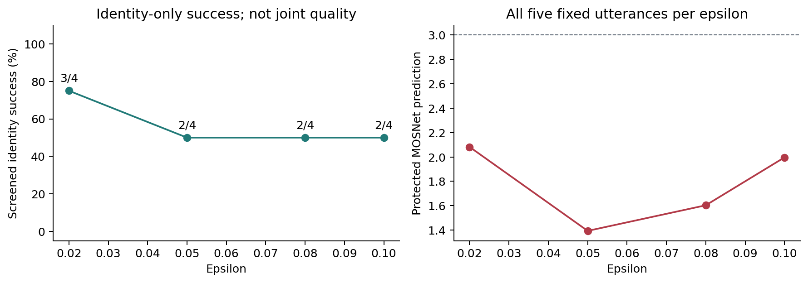
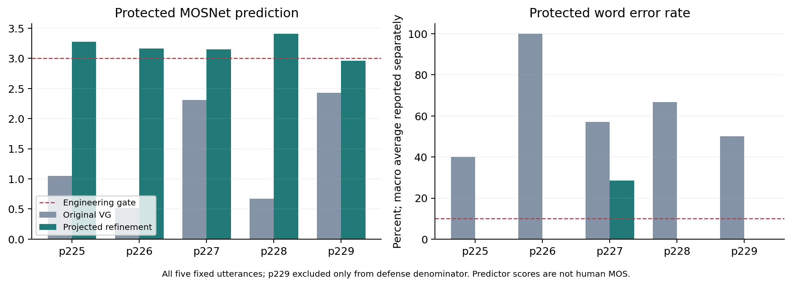
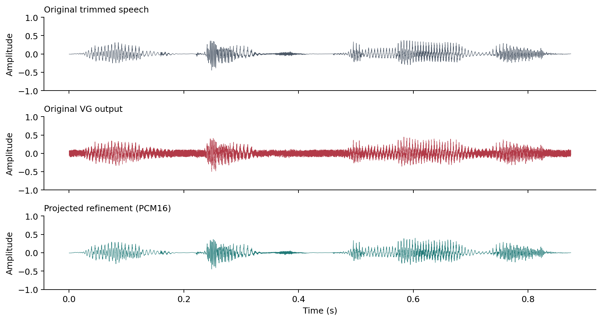
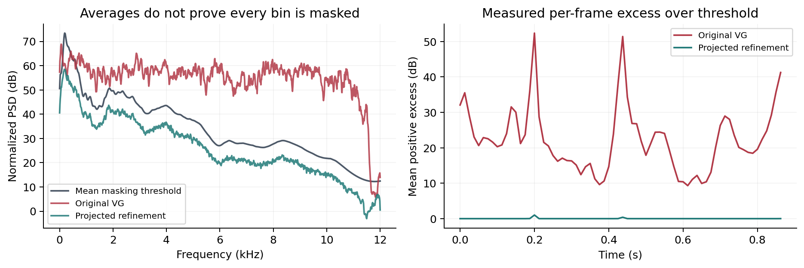
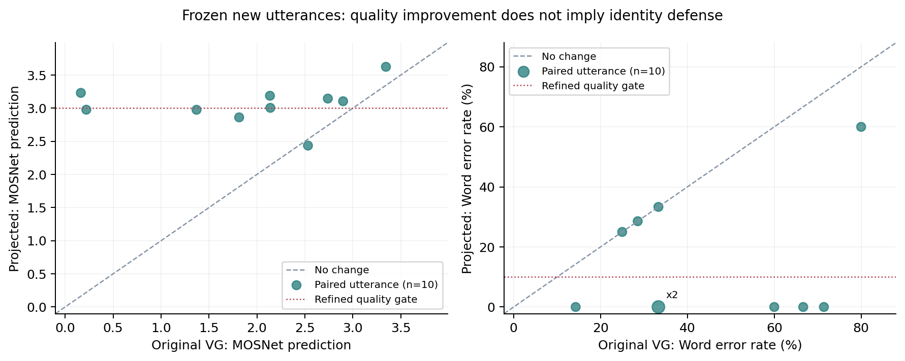
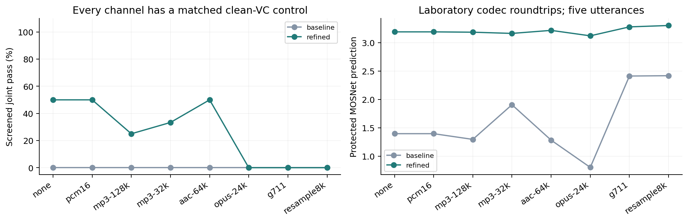
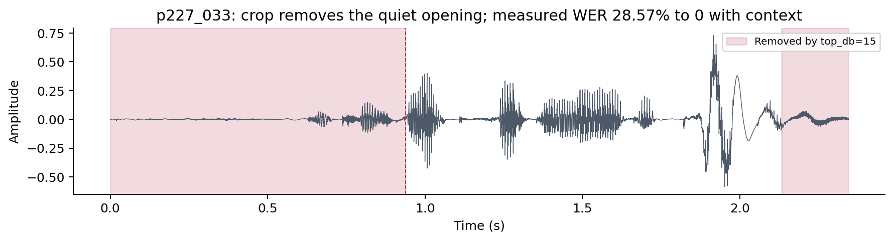

# Voice Guard 语音隐私主动防御复现与质量改进报告

课程 语音识别与合成  |  选题 A036 音频主动防御  |  技术记录更新 2026 年 11 月 9 日

组号：待填写　成员及学号：待填写　指导课程：语音识别与合成

## 摘要

本项目针对零样本语音转换滥用公开语音复制目标声纹的问题，复现 Voice Guard 的时域对抗扰动、可微 mel 特征及心理声学掩蔽约束，并在华为云 Tesla T4 上运行真实 VCTK 音频实验。除原始方法外，实现 emb、fb、e2e 对照和无掩蔽消融，使用独立 ECAPA、MOSNet 预测与 Whisper 人工文本 WER 分别检查身份、质量和内容。

首批固定 5 句中，原始 VG 的保护音频 MOSNet 均值为 1.397，逐句 WER 算术均值为 62.76%。新增谱投影约束后继续优化的方法，将这两项分别改善为 3.192 与 5.71%。PCM16 导出后，p225、p228 同时通过本项目的质量与身份联合门槛；固定参数验证集筛选后为 1/2，开发集为 1/2。这支持小样本质量改进，尚不支持论文总体防御率或人耳不可感知性结论。

原始主表及 ε 扫描的完整状态：已完成。新增 10 句和配对信道/内容源实验：已完成。

事前冻结的 10 个新句子中，原法/改进 MOSNet 为 1.936/3.055，宏平均 WER 为 44.60%/14.69%；联合通过分别为 0/8 与 0/8。这是已见说话人的新句验证，不是未见人物泛化。配对编码与内容源实验进一步检查应用分发条件，所有负结果与分母均保留。

## 1 论文背景与核心问题

零样本语音转换 F(t,x) 从内容音频 t 取得语言内容，从目标音频 x 取得说话人特征。攻击者可以据此合成带目标声纹的新句子。Voice Guard 选择在发布目标音频前加入扰动 δ，尝试使转换器无法再复制该身份，同时让用户仍能正常听清原始语音。

单看“转换后身份改变”不足以证明保护有效：严重噪声、内容丢失以及转换器本身失败，都能产生看似有利的身份结果。因此需要分别验证原始语音身份保真、自然度、内容完整性，以及转换端是否成功。项目将这些维度分开记录，并在计算防护率前筛除干净转换就无法识别目标的样本。

## 2 方法理解与实现

### 2.1 可微特征与时域优化

可微特征提取 H 包含预加重、反射填充 STFT、mel 滤波、对数压缩、裁剪归一化和训练统计量标准化。使用 PyTorch 保留从说话人编码器到波形的梯度；numpy/librosa 参考链用于数值核对。预加重首采样边界与官方参考有差别，测试对齐其公共有效区间，不能把首边界差异误写成完全逐点一致。

设 Es 为 AdaIN-VC 说话人编码器，y 为注册库中与目标身份最不相似的参考语音。攻击目标为：

`L_vc = MSE(Es(H(x+δ)), Es(H(y))) − 0.1 MSE(Es(H(x+δ)), Es(H(x)))`

原始实现参数化 `δ = 2ε tanh(w)`。论文公式与官方代码的幅值系数存在差别，本项目保留官方代码的 2ε，并在报告和参数记录中明确，而不将 ε 直接解释为波形最大变化。

### 2.2 心理声学约束与两阶段算法

掩蔽阈值 θx 由原始语音的归一化功率谱、局部音调掩蔽者、Bark 频率和扩散函数求得。可微 Transform 将扰动功率谱与 θx 置于同一 96 dB 归一化基准，补足原始公开代码未提供的模块。

`L_mask = mean(ReLU(PSD(δ) − θx))`，第二阶段联合损失为 `L_vc + c L_mask`。第一阶段默认优化 3000 步；第二阶段每轮上限 1500 步，并执行 c 搜索。官方成功分支中循环计数额外增加，且每轮重新从第一阶段扰动初始化，本项目保留这一执行语义。因此“3000/1500”不表示总共只执行 4500 步，也不能写成固定 8 次完整第二阶段。

### 2.3 复现边界

| 要素 | 本项目实现 | 解释与限制 |
|---|---|---|
| VC 模型 | 官方 NTU AdaIN-VC；24 kHz；Griffin-Lim | 与原攻击仓库私有/缺失权重配置不完全一致 |
| 攻击身份 | AdaIN-VC Es 注册库，20 人 | 只作为优化代理，不使用评估 ASV 训练扰动 |
| 评估身份 | ECAPA-TDNN 预训练嵌入，20 人闭集最近匹配 | 替代论文 GE2E；不能认证库外人物的真实身份 |
| 质量 | 固定版本第三方 MOSNet 移植 | 原始预测值保留，不裁成 1–5；不是人工 MOS |
| 内容 | Whisper base 与 VCTK 人工文本 | 保护音频对目标文本，转换音频对内容源文本 |
| 谱距离 | mel 特征逐帧 L2 的缩放值 | 仅本项目相对指标，不是论文精确 MCD |
| 数据 | VCTK 22 kHz 镜像子集 | 进入模型前统一重采样；不是原始 48 kHz 全量协议 |

## 3 实验设计与可复核性

子集包含 20 位说话人、865 份原始 WAV 与对应 865 份人工文本。每人排序后前 30 句注册；测试从后续句子中选取，避免注册集重用。下载器按 ZIP 成员 CRC32 校验，上传后校验文件 SHA256。未下载完整压缩包，不能声称通过了 10.69 GB 全 ZIP 的摘要核验。

原主实验固定为 p225_040、p226_039、p227_033、p228_035、p229_032，内容源 p226_002；ε=0.05，种子基数 2026，主表包括 VG、VG w/o P、emb、fb、e2e。ε 扫描为 0.02、0.05、0.08、0.10。每句种子按句子标识派生，独立于执行顺序。

本轮新增句子依据事前冻结协议，从同一批人的排序索引 40 之后选每人前 2 个不超过 3.5 秒的句子，总计 10 句，排除上述 5 句。它们是“新句、已见说话人”，不能称为未见说话人泛化。固定的谱投影参数沿用 11 月 4 日开发结果，新增验证期间不调参。

| 说话人 | 新增句子 |
|---|---|
| p225 | p225_051、p225_053 |
| p226 | p226_045、p226_047 |
| p227 | p227_042、p227_043 |
| p228 | p228_042、p228_043 |
| p229 | p229_041、p229_042 |

### 3.1 判定与统计口径

身份维条件为保护音频仍判为 X、保护后转换不再判为 X。另要求本条件下干净转换能够判为 X，才计入筛选后的分母。缺失 ASV、转换错误或未完成文件不算成功；分母为 0 时写 N/A。

工程联合门槛额外要求保护音频 MOSNet≥3、目标句 WER≤0.10。论文 ASR 内容完整性阈值与 WER 的映射未被充分说明，因此此门槛是可复核的代理定义，不是论文 Eq.9/10 的逐项等价复现。WER 按逐句比例算术平均，未冒充词数加权语料 WER。原音质量、转换质量分别保留，干净转换的内容错误不归因于扰动。

每句产物包括原音、保护音频、内容源、干净转换与保护后转换，以及参数、种子、ASV、耗时和摘要。完成的句子才允许续跑跳过；改变权重、输入、实验参数或审计脚本时使用新目录。共享说话人和内容源会产生相关性，二项 Wilson 区间仅作描述，不能视为跨人群泛化的置信保证。

## 4 原始方法与消融结果

| 方法 | 有效句数 | 筛选后身份成功 | 保护 MOS | 保护 WER | 项目谱距离 |
|---|---|---|---|---|---|
| main_vg | 5/5 | 2/4 | 1.397 | 62.76% | 35.370 |
| main_vg-nop | 5/5 | 2/4 | 0.756 | 69.43% | 38.221 |
| main_emb | 5/5 | 1/4 | 3.208 | 5.71% | 3.209 |
| main_fb | 5/5 | 0/4 | 3.243 | 5.71% | 3.208 |
| main_e2e | 5/5 | 1/4 | 3.209 | 5.71% | 3.168 |

主表中的成功率仅为身份维；即使比例较高，也不能据此宣布音频质量过关。p229 的干净转换已被判为其他人，在所有原始方法相同控制下必须从防护分母排除，但仍保留其质量分数。

| 方法 | 完成质量评估 | 筛选后联合通过 |
|---|---|---|
| main_vg | 5 | 0/4 |
| main_vg-nop | 5 | 0/4 |
| main_emb | 5 | 1/4 |
| main_fb | 5 | 0/4 |
| main_e2e | 5 | 1/4 |

同一批干净裁剪语音的 MOSNet 均值为 3.255、宏平均 WER 为 5.71%。原始 VG 及无掩蔽消融均没有联合通过样本，emb 与 e2e 各有 1/4；这说明质量与身份须联合评估，也不支持把原方法包装成已达到论文质量。

### 4.1 扰动强度扫描

| 条件 | 有效句数 | 筛选后身份成功 | 保护 MOS | 保护 WER | 项目谱距离 |
|---|---|---|---|---|---|
| eps_.02 | 5/5 | 3/4 | 2.082 | 29.71% | 23.365 |
| eps_.05 | 5/5 | 2/4 | 1.394 | 82.76% | 35.353 |
| eps_.08 | 5/5 | 2/4 | 1.604 | 96.00% | 40.815 |
| eps_.10 | 5/5 | 2/4 | 1.996 | 102.67% | 43.166 |

ε 变化可能同时改变转换端破坏效果与原始身份保真，较大扰动并不必然提高有效防护。需要结合质量指标阅读，而不是只挑身份变化最大的条件。表中“未完成”表示没有获得完整质量结果，不能当作 0 或用历史报告中的近似数值补齐。

图 1 ε 扫描的身份维成功与质量。四档均无联合通过样本。ε=0.05 的主表与扫描是名义参数相同的独立运行，宏平均 WER 分别为 62.76% 与 82.76%。两份 manifest 的 SHA256 完全相同，每句种子、flag 和 c 相同，但 WAV 最大样本差为 0.0092–0.0146。WER 均值差异集中于 p226：从 100% 变为 200%，其余四句相同；WER 可因插入词超过 100%。波形差异原因尚未通过独立控制定位，不能据此断言由 GPU 并行或解码引起。两次结果均保留，不择优合并，也不声称逐位复现。诊断见 nominal-repeat-diagnostic.json。

### 4.2 同一音频的 ASR 解码重复性诊断

在发现同一 WAV 的跨阶段 WER 不同后，追加不修改音频的控制。对原 VG 五个保存文件，各用种子 2026、2027，比较 Whisper 默认温度回退与 temperature=0。此检查在冻结实验结束后设计，单列为事后诊断，不替代原表或据此挑选较低分数。

| 同一文件 | 默认 WER 2026 / 2027 | 固定温度 0 WER 2026 / 2027 |
|---|---|---|
| p225_040 | 40.00% / 40.00% | 40.00% / 40.00% |
| p226_039 | 100.00% / 866.67% | 100.00% / 100.00% |
| p227_033 | 57.14% / 57.14% | 57.14% / 57.14% |
| p228_035 | 66.67% / 66.67% | 66.67% / 66.67% |
| p229_032 | 50.00% / 50.00% | 50.00% / 50.00% |

默认解码有 1/5 句在两种子间改变转录，五句宏平均 WER 为 62.76% / 216.10%；固定温度 0 改变 0/5 句，宏平均 WER 为 62.76% / 62.76%。

p226 的默认解码两次均进入温度 1 的回退，转录从短语变成长串插入，导致 WER 显著超过 100%。同一音频下改变解码种子即可改变评分，说明默认解码随机性确实能影响噪声音频的 WER。固定温度控制仅在这五个文件上稳定，不能外推所有输入，也不能解释前述两次优化为什么产生不同波形。

主表、冻结新句及信道结果均保留原默认解码协议；信道中还保留每次完整转录。原 compute_wer 未逐音频固定解码种子，扩展脚本的种子派生/调用顺序也不同，因此跨阶段绝对 WER 不能假定逐位稳定。后续正式扩大实验应在采集前统一解码选项和逐音频种子，并报告重复性；本次没有重写冻结结果。

## 5 质量失效分析与改进

原始 VG 的五句保护音频均出现明显的客观质量问题。直接缩小扰动可恢复 MOS/WER，但开发对照中同时丢失防护；只投影到掩蔽谱约束也出现同样现象。由此可见，单纯降低噪声能量并不等于保留声纹扰动方向。

本项目增加投影约束后的继续优化：先做 30 次 STFT 幅度限制与波形重建，再以原有 Es 嵌入目标优化 1000 步，每步后投影并限制峰值至 2ε，结束再投影 30 次。学习率 0.0003，掩蔽余量 3 dB。MOSNet、Whisper、ECAPA 都没有加入优化损失，评估模型保持独立。

| 句子 | VG MOS | 改进 MOS | VG WER | 改进 WER | 改进转换身份 | 联合判定 |
|---|---|---|---|---|---|---|
| p225_040 | 1.049 | 3.275 | 40.00% | 0.00% | p246 | 通过 |
| p226_039 | 0.519 | 3.165 | 100.00% | 0.00% | p226 | 未通过 |
| p227_033 | 2.313 | 3.153 | 57.14% | 28.57% | p227 | 未通过 |
| p228_035 | 0.673 | 3.409 | 66.67% | 0.00% | p226 | 通过 |
| p229_032 | 2.432 | 2.958 | 50.00% | 0.00% | p231 | 排除 |

图 2 首批 5 句的真实 PCM16 导出后结果。全部失败样本纳入均值；p229 只从防护分母排除。低于 1 的 MOSNet 原始预测值未被隐藏或裁剪。

开发两句中联合通过 1/2；固定参数验证的三句中，p229 因干净转换失败排除，余下两句通过 1/2。合计 2/4 是观察结果，不能写成论文级总体 50% 防御率。p225 在最终脚本独立重跑后 MOS=3.280、WER=0，仍通过联合门槛；波形 SHA256 不同，最大样本差 0.01367、差值 RMS 0.001279，未声称 CUDA 逐位确定性。

图 3 同一句在相同幅度坐标下的原音、原始 VG、改进输出；未独立归一化各条波形以夸大视觉相似性。

图 4 掩蔽阈与扰动平均 PSD、逐帧平均正超额。平均曲线低于阈值不表示所有时频格都满足约束；两个通过样本仍有约 0.6–0.7% 的时频格超阈，SNR 约 14 dB，不能因此声称人耳完全不可感知。

### 5.1 新句扩展验证

| 方法 | 新句总数 | 干净转换通过 | 联合通过 | 全部句 MOS | 全部句 WER |
|---|---|---|---|---|---|
| baseline | 10 | 8 | 0/8 | 1.936 | 44.60% |
| refined | 10 | 8 | 0/8 | 3.055 | 14.69% |

baseline 逐句记录

| 句子 | MOS | WER | 保护身份 | 转换身份 | 筛选后联合通过 |
|---|---|---|---|---|---|
| p225_051 | 2.899 | 33.33% | p225 | p226 | 未通过 |
| p225_053 | 2.533 | 60.00% | p225 | p234 | 未通过 |
| p226_045 | 2.740 | 14.29% | p226 | p226 | 未通过 |
| p226_047 | 1.815 | 25.00% | p226 | p226 | 未通过 |
| p227_042 | 0.221 | 28.57% | p227 | p226 | 未通过 |
| p227_043 | 0.164 | 33.33% | p227 | p226 | 未通过 |
| p228_042 | 2.140 | 80.00% | p228 | p234 | 未通过 |
| p228_043 | 3.346 | 33.33% | p230 | p234 | 未通过 |
| p229_041 | 1.370 | 71.43% | p229 | p234 | 排除 |
| p229_042 | 2.136 | 66.67% | p229 | p234 | 排除 |

refined 逐句记录

| 句子 | MOS | WER | 保护身份 | 转换身份 | 筛选后联合通过 |
|---|---|---|---|---|---|
| p225_051 | 3.105 | 0.00% | p225 | p225 | 未通过 |
| p225_053 | 2.436 | 0.00% | p225 | p230 | 未通过 |
| p226_045 | 3.145 | 0.00% | p226 | p226 | 未通过 |
| p226_047 | 2.862 | 25.00% | p226 | p226 | 未通过 |
| p227_042 | 2.977 | 28.57% | p227 | p226 | 未通过 |
| p227_043 | 3.231 | 33.33% | p227 | p227 | 未通过 |
| p228_042 | 3.006 | 60.00% | p228 | p231 | 未通过 |
| p228_043 | 3.625 | 0.00% | p228 | p228 | 未通过 |
| p229_041 | 2.976 | 0.00% | p229 | p231 | 排除 |
| p229_042 | 3.188 | 0.00% | p229 | p231 | 排除 |

新句零扰动控制的 MOSNet 均值为 3.088、宏平均 WER 为 9.50%。因此保护音频的全部内容错误不能都归因于扰动；也不能只看相对原 VG 的改善，就忽略相对干净原音仍有的质量损失。

在改进法的新句中，3 句通过干净控制和保护质量门槛，但转换后身份仍为目标；另有 3 句保留身份维防护，却未通过保护质量门槛。质量恢复与转换端防护之间仍有权衡，质量均值改善不能替代联合成功率。

质量通过但转换恢复目标的句子：p225_051、p226_045、p228_043。未筛选同时达标、但干净转换已失败的句子：p229_042；后者仍不能计为防御成功。没有根据这些验证失败重新调参或改动门槛。

图 5 新 10 句的原法/固定改进配对质量；每点一对，不因联合失败排除。MOS 越高、WER 越低越好，质量达标仍需另检身份。

## 6 接近真实应用的信道实验

场景是受保护语音在分发中经历有损编码、采样率变化或量化。处理条件为原样、PCM16、MP3 128/32 kbps、AAC 64 kbps、Opus 24 kbps、G.711 μ-law、8 kHz 往返重采样。这是 ffmpeg 控制实验，不是微信或视频平台线上实测。

每个句子、内容源、信道都对干净目标音频和保护目标音频进行同条件处理，再重新合成两份 VC 输出。这样可区分防护丢失、保护音频质量退化，以及干净模型原本就失败。记录全部转录、ASV 余弦分数、编码器版本、产物摘要与耗时。对于原样联合成功的样本，另记录经过信道后仍成功的数量，不能因某个信道把更多干净控制排除而制造比例提升。

原样通道精确保留读入的样本，PCM16 通道单独量化。原 VG 的源 WAV 已是 PCM16，再量化预期不改变样本；改进优化源 WAV 为 FLOAT，PCM16 条件则另测最终量化影响。有损编解码统一从浮点容器输入并解码回浮点。8 kHz 重采样中间文件也保持浮点，避免混入未声明的 PCM16 量化。记录编码后样本数，保留 AAC 填充与重采样舍入，不对结果静默截断或时移对齐。这些长度/边界变化可能影响质量与身份，不能把所有差异归因于扰动被滤除。

### channels_baseline

| 处理条件 | 总试验 | 筛选后联合通过 | 保护 MOS | 保护 WER | 原样成功中保留 |
|---|---|---|---|---|---|
| aac-64k | 5 | 0/4 | 1.283 | 57.05% | N/A |
| g711 | 5 | 0/1 | 2.413 | 56.10% | N/A |
| mp3-128k | 5 | 0/4 | 1.297 | 62.76% | N/A |
| mp3-32k | 5 | 0/3 | 1.907 | 65.14% | N/A |
| none | 5 | 0/4 | 1.397 | 129.43% | N/A |
| opus-24k | 5 | 0/3 | 0.803 | 71.33% | N/A |
| pcm16 | 5 | 0/4 | 1.397 | 76.10% | N/A |
| resample8k | 5 | 0/1 | 2.419 | 56.10% | N/A |

### channels_refined_dev

| 处理条件 | 总试验 | 筛选后联合通过 | 保护 MOS | 保护 WER | 原样成功中保留 |
|---|---|---|---|---|---|
| aac-64k | 2 | 1/2 | 3.295 | 0.00% | 1/1 |
| g711 | 2 | N/A | 3.325 | 33.33% | 0/1 |
| mp3-128k | 2 | 0/2 | 3.218 | 0.00% | 0/1 |
| mp3-32k | 2 | 1/2 | 3.243 | 0.00% | 1/1 |
| none | 2 | 1/2 | 3.220 | 0.00% | 1/1 |
| opus-24k | 2 | 0/2 | 3.154 | 16.67% | 0/1 |
| pcm16 | 2 | 1/2 | 3.220 | 0.00% | 1/1 |
| resample8k | 2 | N/A | 3.341 | 33.33% | 0/1 |

### channels_refined_validation

| 处理条件 | 总试验 | 筛选后联合通过 | 保护 MOS | 保护 WER | 原样成功中保留 |
|---|---|---|---|---|---|
| aac-64k | 3 | 1/2 | 3.167 | 9.52% | 1/1 |
| g711 | 3 | 0/1 | 3.250 | 9.52% | 0/1 |
| mp3-128k | 3 | 1/2 | 3.165 | 9.52% | 1/1 |
| mp3-32k | 3 | 0/1 | 3.113 | 9.52% | 0/1 |
| none | 3 | 1/2 | 3.173 | 9.52% | 1/1 |
| opus-24k | 3 | 0/1 | 3.101 | 9.52% | 0/1 |
| pcm16 | 3 | 1/2 | 3.173 | 9.52% | 1/1 |
| resample8k | 3 | 0/1 | 3.279 | 9.52% | 0/1 |

图 6 各信道的联合通过率与保护语音 MOSNet；折线连接固定处理条件，不表示连续趋势。每种条件都有自己的干净 VC 分母。

### 6.1 内容源敏感性

补充用 p226_002、p225_002、p227_002 三个内容源在原样和 PCM16 下重复转换。内容源变化可以改变合成质量、ASV 排名和筛选分母，同一目标的这些重复视角不是独立受试者。报告保留每种内容源的干净控制，防止只展示最有利的一句话。

### contents_baseline

| 内容源 | 信道 | 试验数 | 干净转换通过 | 联合通过 |
|---|---|---|---|---|
| p226_002 | none | 5 | 4 | 0/4 |
| p226_002 | pcm16 | 5 | 4 | 0/4 |
| p225_002 | none | 5 | 4 | 0/4 |
| p225_002 | pcm16 | 5 | 4 | 0/4 |
| p227_002 | none | 5 | 4 | 0/4 |
| p227_002 | pcm16 | 5 | 4 | 0/4 |

### contents_refined_dev

| 内容源 | 信道 | 试验数 | 干净转换通过 | 联合通过 |
|---|---|---|---|---|
| p226_002 | none | 2 | 2 | 1/2 |
| p226_002 | pcm16 | 2 | 2 | 1/2 |
| p225_002 | none | 2 | 2 | 0/2 |
| p225_002 | pcm16 | 2 | 2 | 0/2 |
| p227_002 | none | 2 | 2 | 1/2 |
| p227_002 | pcm16 | 2 | 2 | 1/2 |

### contents_refined_validation

| 内容源 | 信道 | 试验数 | 干净转换通过 | 联合通过 |
|---|---|---|---|---|
| p226_002 | none | 3 | 2 | 1/2 |
| p226_002 | pcm16 | 3 | 2 | 1/2 |
| p225_002 | none | 3 | 2 | 1/2 |
| p225_002 | pcm16 | 3 | 2 | 1/2 |
| p227_002 | none | 3 | 2 | 1/2 |
| p227_002 | pcm16 | 3 | 2 | 1/2 |

### 6.2 扩展结果的解释

新 10 句的配对平均变化为 MOSNet +1.119、宏平均 WER -29.90 个百分点。所有 10 对均纳入，不根据身份或质量事后删句。两方法的干净转换筛选差异为 0/10，联合结果分别使用各自实测分母，不择优替换。

| 新句方法 | 仅保护质量与原身份通过 | 仅身份维通过 | 联合通过 |
|---|---|---|---|
| baseline | 0/10 | 7/10 | 0/8 |
| refined | 4/10 | 5/10 | 0/8 |

质量门槛通过与转换端身份变化是不同条件。即使质量均值改善，也不能把没有联合通过的句子解释成有效保护。新句验证不参与调参，未达到的目标作为负结果保留。

信道审计以本次原样条件作为保留率起点。转换随机种子按“目标句:内容源”固定，与旧质量评测按“目标句:scale”派生的种子不同；因此本审计的原样判定独立记录，不强行套用历史 2/4。原样保留源文件解码后的样本，PCM16 则显式量化；原 VG 源文件已为 PCM16，改进源文件为 FLOAT，量化的作用应分别解释。

| 信道 | 原 VG 成功保留 | 改进开发成功保留 | 改进验证成功保留 | 丢失干净控制合计 |
|---|---|---|---|---|
| none | N/A | 1/1 | 1/1 | 0 |
| pcm16 | N/A | 1/1 | 1/1 | 0 |
| mp3-128k | N/A | 0/1 | 1/1 | 0 |
| mp3-32k | N/A | 1/1 | 0/1 | 1 |
| aac-64k | N/A | 1/1 | 1/1 | 0 |
| opus-24k | N/A | 0/1 | 0/1 | 1 |
| g711 | N/A | 0/1 | 0/1 | 2 |
| resample8k | N/A | 0/1 | 0/1 | 2 |

本次改进法 p225 在 MP3 128 kbps 下保护质量仍通过、干净转换仍为 p225，但保护后转换也恢复为 p225，属于可定位的身份维防护丢失。同一句在 MP3 32 kbps 却保留联合通过，因此不能宣称码率越低防护必然越差。p228 在 MP3 32 kbps 下的干净转换已经变为 p241，应排除而不是当作扰动被消除。

G.711 和 8 kHz 重采样使两个原样成功样本的干净转换控制都失败；两者成功保留为 0/2，但不能单凭这个数推断防御扰动失效。Opus 下 p225 是身份维防护丢失，p228 则是干净转换失败，需要区别解释。

内容源也影响局部有效性：改进开发组在 p226_002 和 p227_002 下各联合通过 1/2，换成 p225_002 后为 0/2；验证组在三种内容源下均为 1/2。以上为固定五句的相关重复，不能作为对所有内容的稳健性保证。

### 6.3 编码后机制诊断

下面以 MP3 32 kbps 为固定诊断条件，报告转换身份的“最大非目标余弦减目标余弦”。正值表示非目标排名领先，负值表示仍是目标身份；不是认证系统阈值。高频差分比取共同前缀差分的 4 kHz 以上能量比例，编码延迟、非线性和边界变化也会影响差分，不能当成独立扰动被滤除的直接证明。

| 实验组/目标 | 原样→MP3 身份余量 | 原样→MP3 高频差分比 | MP3 干净/质量/身份 |
|---|---|---|---|
| baseline/p225_040 | 0.127 → 0.031 | 0.571 → 0.443 | 通过/失败/通过 |
| baseline/p226_039 | -0.038 → 0.040 | 0.574 → 0.494 | 通过/失败/失败 |
| baseline/p227_033 | 0.237 → 0.140 | 0.531 → 0.437 | 通过/失败/通过 |
| baseline/p228_035 | 0.183 → 0.121 | 0.571 → 0.450 | 失败/失败/通过 |
| baseline/p229_032 | 0.164 → 0.179 | 0.551 → 0.417 | 失败/失败/通过 |
| refined_dev/p225_040 | 0.021 → 0.010 | 0.018 → 0.037 | 通过/通过/通过 |
| refined_dev/p226_039 | -0.170 → -0.223 | 0.055 → 0.101 | 通过/通过/失败 |
| refined_validation/p227_033 | -0.083 → -0.122 | 0.004 → 0.009 | 通过/失败/失败 |
| refined_validation/p228_035 | 0.142 → 0.131 | 0.028 → 0.061 | 失败/通过/通过 |
| refined_validation/p229_032 | 0.266 → 0.281 | 0.034 → 0.113 | 失败/失败/通过 |

这些配对观测能定位失败发生在质量、干净控制还是保护后身份环节；没有做频带消融或控制时延的独立因果实验，因此不把高频变化断言为唯一原因，也没有将未经实现的 EOT 当作改进结果。

## 7 裁剪造成内容丢失的案例

p227_033 原句为 “It is not for any other purpose.”。基线 top_db=15 预处理裁掉较轻的开头，连未加扰动的保存原音都被 Whisper 识别成缺少 “It is”，WER 为 28.57%。把同一个扰动只叠加在原裁剪区间、同时保留完整上下文后，原音与保护音频 WER 都恢复到 0。

图 7 原始波形与被移除的区间。该控制说明错误不能全归因于对抗扰动；它也提示直接拿裁剪后的句子对完整人工文本评分，会混入预处理造成的内容损失。

修复并未让此句全部达标：完整保护音频 MOS 仅 2.591，转换仍判为 p227。p228 完整原音的干净转换已判为 p231，因此完整上下文版本不能把 p228 算为防护成功。MOSNet 对静音/短句长度敏感也是可能解释，但本实验尚不足以把变化完全归因于单一机制。我们把此诊断作为独立后续协议，不覆盖原固定参数验证。

### 7.1 新句完整上下文的事后诊断

在看到新句的冻结结果后，追加同一 10 句的完整上下文诊断。只在原 top_db=15 裁剪区间叠加已保存的扰动，区间外原样恢复，不再优化或调参；导出 PCM16，以完整人工文本和重新生成的完整原音 VC 作为控制。事后协议见 posthoc-context-protocol.json。这不是原冻结验证，也不按每句选取两个协议中较好的结果。

| 处理协议 | 干净 MOS / WER | 保护 MOS / WER | 联合通过 |
|---|---|---|---|
| 原裁剪 | 3.088 / 9.50% | 3.055 / 14.69% | 0/8 |
| 恢复完整上下文 | 2.905 / 1.67% | 2.884 / 3.10% | 0/7 |

恢复上下文后，保护语音 WER 从 14.69% 降为 3.10%，但 MOSNet 从 3.055 变为 2.884，联合通过为 0/7。干净完整原音的 MOSNet 也为 2.905，提示代理自然度分数会随上下文和长度变化；没有人耳证据证明完整语音听起来更差。

| 新句 | 裁剪保护 WER | 完整原音 WER | 完整保护 WER | 完整条件联合 |
|---|---|---|---|---|
| p225_051 | 0.00% | 0.00% | 0.00% | 未通过 |
| p225_053 | 0.00% | 0.00% | 0.00% | 未通过 |
| p226_045 | 0.00% | 0.00% | 0.00% | 未通过 |
| p226_047 | 25.00% | 0.00% | 0.00% | 未通过 |
| p227_042 | 28.57% | 0.00% | 14.29% | 排除 |
| p227_043 | 33.33% | 16.67% | 16.67% | 未通过 |
| p228_042 | 60.00% | 0.00% | 0.00% | 未通过 |
| p228_043 | 0.00% | 0.00% | 0.00% | 未通过 |
| p229_041 | 0.00% | 0.00% | 0.00% | 排除 |
| p229_042 | 0.00% | 0.00% | 0.00% | 排除 |

完整上下文改变输入长度、静音比例和 VC 目标表征，也可能改变干净筛选分母。即使内容指标改善，仍须同时满足质量与身份；本诊断不能单独证明跨场景防护提高。

## 8 系统与华为云部署

部署环境为 Ubuntu 22.04.2、Python 3.10.12、Tesla T4 15360 MiB 可见显存、31 GiB 内存、约 100 GB 系统盘；NVIDIA 驱动 580.178.04，torch/torchaudio 2.5.1 CUDA 12.4。源码、模型与输出分离。模型与数据摘要、注册清单、依赖检查和实验级预检共同构成环境证据。

统一 Pipeline 供 Gradio 和课程平台 FastAPI adapter 调用。输入要保护的语音与可选参考语音，输出原音、保护音频、扰动、干净转换、保护后转换和 JSON 报告。新增可选 vg-projected 方法与保留完整音频选项，默认仍可运行原始 VG。两个方法在报告中明确区分。

修复自动识别上传音频时的采样率和声道问题；依据缺失 ASV 与干净转换筛选统一判定，避免错误显示成功；把 GPU 请求串行化并移入线程池以保持接口可响应。接口身份结果明确注明尚未联合质量评估。课程前端通过真实 schema 校验配置、默认参数和可追溯样例，并进行平台测试与构建。

11 月 9 日真实 GPU API 验证使用 22.05 kHz 双声道上传、自动身份和快速改进模式，49.23 秒返回，6 份产物均可下载；GPU 工作期间 health 响应 0.078 秒。真实课程浏览器点击样例、提交请求、播放 5 份音频并下载保护结果，48.33 秒完成，无页面错误。Gradio 原方法保留上下文请求 34.59 秒完成。三次测试的干净 VC 均未通过身份筛选，页面正确显示未通过；这些验证证明服务可运行，不是防护成功率证据。记录及截图见 docs/evidence/2026-11-09/platform-api-projected.json、platform-browser.json、gradio-api.json。

服务绑定云端回环地址，经 SSH 隧道提供本机 7860/8020 访问；这能在 GPU ECS 上执行模型并从本机课程前端调用，但不等于已经提供公开 HTTPS 生产接口。实例关机后无法实时处理，验收前须开机、检查服务和隧道。实验脚本的时限只约束任务，不停止 ECS 计费。

## 9 加分证据与限制

| 层级 | 对应工作 | 证据边界 |
|---|---|---|
| 问题发现 | 质量失真、轻声裁剪、信道/内容源敏感性 | 真实样本与实验条件明确，不冒称平台线上场景 |
| 定量验证 | 配对 clean/protected、固定原句及新增句子 | 每个条件重新筛选，报告失败与缺项 |
| 原因分析 | 掩蔽超额、波形、裁剪区间、ASV 余弦变化 | 平均 PSD 与因果机制不同，相关性不直接等于因果 |
| 改进验证 | 固定谱投影继续优化、PCM16 导出、独立重跑 | 局部有效，有负结果；不保证满分或普遍成功 |

论文白盒 VG 表 2 报告的保护音频 MOS 为 4.07、WER 为 7.84%，本项目不能只比较一个更低的 WER 就声称达到或超过论文：数据、权重、识别器与自然度预测系统不同，且极短句 WER 分辨率很粗。原方法输出、改进输出与干净控制均应试听；目前没有人类听评数据。

当前还未验证 VQMIVC 等其他 VC 模型、GE2E 原评估器、真实移动端重录、远场麦克风、平台转码、长语音和库外说话人。数据只覆盖 20 人注册与小批测试句。项目谱距离不等同论文 MCD。结果可以支持可运行的工程复现和带失败记录的探索，不能作为真实身份保护或安全保证。

## 10 复现与交付

仓库分支 `codex/huawei-ecs-reproduction`。环境和模型下载命令见根 README、华为云操作手册；`deploy/run_course_campaign.py --max-hours 3` 续跑主实验并执行冻结扩展；`tools/build_course_figures.py` 从原始产物生成图；本报告由 `tools/build_course_report.py` 重建。所有未完成实验须在报告状态中保留。

文本证据保存在 `docs/evidence/2026-11-04/` 与 `docs/evidence/2026-11-09/`。WAV、模型、数据和本机私钥不进入普通源码提交；课程样例仅保留少量可追溯音频及摘要。权重分发压缩包、来源/许可证和摘要可提前准备；云盘分享地址需由资源所有者上传生成，不能使用不存在的链接。

课程平台组号与成员信息、互评问卷、按姓名学号后四位命名和验收后 5 个工作日内的邮件提交属于真人身份事项。项目提供填写材料与提交说明，不伪造已完成状态，也不自动发送邮件。

## 参考资料

[1] Jingyang Li, Dengpan Ye, Long Tang, Chuanxi Chen, Shengshan Hu. Voice Guard: Protecting Voice Privacy with Strong and Imperceptible Adversarial Perturbation in the Time Domain. IJCAI 2023, 4812–4820. https://www.ijcai.org/proceedings/2023/535

[2] Voice Guard 官方部分代码：WHUB401/Voice-Guard。复现边界与缺失模块见本项目审计记录。

[3] Chou 等 AdaIN-VC 官方实现：jjery2243542/adaptive_voice_conversion；NTU 官方 VCTK 权重与配置。

[4] ECAPA 模型：speechbrain/spkrec-ecapa-voxceleb，固定资产摘要见下载记录；数据：arampacha/vctk_22kHz 的 raw_data.zip 镜像。

[5] 第三方 MOSNet 移植：1NEYRON1/mosnet，提交 4162a3e63ac725ecf7dce8dee3aa71e7afd9c65d；Whisper base 权重 SHA256 ed3a0b6b1c0edf879ad9b11b1af5a0e6ab5db9205f891f668f8b0e6c6326e34e。

[6] 用户提供课程大作业 PPT 第 2–5 页；统一展示平台 lym-lab/algorithm_research_frontend 的算法接入规范及提交指南。
