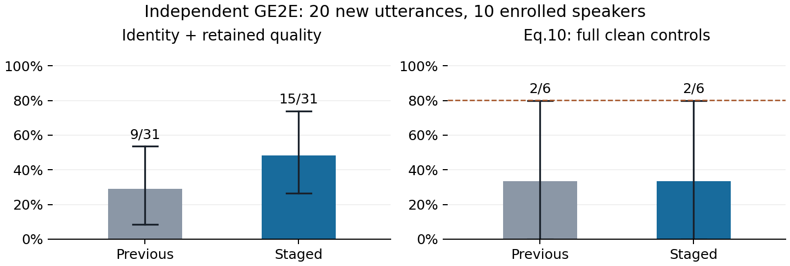

# Voice Guard 原生参考与两阶段优化实验

本轮继续追赶原文质量，独立保留上一轮十五句结果。所有新增验证句、方法、选择规则和评估门槛在运行前冻结；旧验证只用于诊断，不再称为未知数据。

## 为什么原来的防护率难以达到论文水平

保护原音的预测 MOS 已为 4.063、Whisper base 逐句 WER 为 4.61%，两套声纹模型均保留 15/15 句原音身份。主要差距是转换后身份仍经常保留，不能只凭原音听起来正常就宣布防护成功。

| 问题 | 本轮检查得到的证据 | 处理方式 |
|---|---|---|
| 攻击目标参考的上下文不一致 | 旧 Es 注册流程把整段波形（含静音）送入不裁剪的可微 H；实际 VC 用 top_db=15 裁剪后再编码 | 依实际 get_spectrograms 流程重建二十人各前三十句的原生目标参考 |
| 内部“变身份”标志不可靠 | 相同十五句干净原音在旧注册库中只认对 6/15，原生注册库认对 15/15；干净转换分别为 13/30 和 30/30 | 不把旧内部 flag 当成功证据；GE2E 独立检查实际导出的转换 WAV |
| 原改进与原文优化路径不同 | 上一轮从微小噪声起步并立即施加谱投影，使用余弦目标；原文 Eq.3 使用距离目标，先强后隐 | 新候选先进行 3000 步 MSE 强扰动，再用 1500 步逐渐收紧掩蔽约束 |
| 编码器改变不等于生成语音身份改变 | 重建原生注册后，旧保护原音仍有 14/15 被编码器判为原身份，保护转换仍有 22/30 被判为原身份；GE2E 的严格联合仅约四成 | 在原生嵌入、反馈及解码频谱目标之间做预先声明的开发比较 |
| 模型和判据差异限制数值可比性 | 原文二十人各百句，且原始实现、完整评估检查点不公开；本项目包含更严格的干净转换质量控制 | 报告完整分母、同句配对对照、独立 GE2E 结果，不把内部判定修正算作算法提升 |

旧 H 与实际输入的声纹余弦一致性超过 0.99997，故当前证据不支持将主要差距归因于可微特征的大范围数值错误。注册库的静音上下文不一致，是另一处独立问题。原生参考诊断在同一批旧 WAV 上完成，没有更改这些 WAV 或 GE2E 观测。

## 本轮冻结方案

初轮协议路径为 `docs/evidence/2026-11-09-staged/protocol.json`，SHA256 为 `16a228f795b33796dae973dca2d4a3ddbc332d02d24ba6ff8196157690628eec`。该协议的三候选开发结果和首次选择独立保留。

开发沿用 p225_040、p226_039、p227_033 三句。新验证为十位已注册说话人各两个新句，共二十句；每句以两个固定内容源转换。每个验证句都运行上一轮反馈方法和一个全局选定的新候选，保持音频导出、转换种子、内容源和评估一致。

新候选为原生嵌入 MSE/SNR20、原生反馈 MSE/SNR20、解码频谱 MSE/SNR18。强扰动阶段允许 SNR15，隐藏阶段逐渐收紧到最终 SNR 及掩蔽阈值。最终仍保留完整上下文，只扰动原裁剪区间，并约束峰值和波形余量。

新目标说话人按 ECAPA 注册均值的最低余弦相似度选择，优化参考采用其最前四个注册句的原生 Es 特征。ECAPA 因而参与了目标身份选择，不能称为本轮完全独立的声纹评估；GE2E 是主要独立声纹模型。两者均不进入梯度损失。

主评估为 GE2E、原始 MOSNet、small.en、冻结的 BasicTextNormalizer WER；ECAPA/base 并列保留。另记录 EnglishTextNormalizer WER，专门检查 Four/4 等文本形式因素，不能用于改变主判据或事后选择方法。主判据门槛仍为 MOS>=3、WER<=10%。

新优化保留原文 MSE 与 0.1 排斥项的思路；隐藏阶段用投影约束逐渐收紧，未声称等同于原文的 alpha 二分实现。原生参考、目标方向、距离损失和优化路径一起变化，配对对照只能评价这些改变的合并效果，不能单独证明每项的因果贡献。

开发最多四十五分钟，验证最多七十五分钟。超时停止任务，不会自动停止 ECS 计费。开发、全局选择及配对新验证均已完整结束，最终结果见下文。

初轮开发完整 24 条评测，原生嵌入与反馈候选严格联合均为 4/6，解码目标为 3/6；同句基线为 3/6。按声明的规则首次选出 native_emb_snr20。强阶段诊断只在这三句开发语音上进行，强扰动严格联合也是 4/6；p225_040 的强阶段未保留保护原音质量。这个小样本不支持把全部差距归因于隐藏阶段，也没有证据表明只加大扰动就能解决联合目标。这不是逐句强弱版本择优，最终主表仍统一使用完整隐藏后的音频。

在未运行二十句新验证前，追加一次仅用原三句的开发比较：初轮选中者与更接近原文 Eq.3/7/8 的软掩蔽候选，另重跑相同旧方法作为对照，共十八条记录。追加协议为 `docs/evidence/2026-11-09-staged/final/protocol.json`，SHA256 为 `35a1373e6fa15baffa822794dd9b136424a7dec1111a17d7f145d9777e4ea3ba`。最终配置仍按原选择规则、只根据开发数据选一次，随后才进入新验证。

软候选使用原生参考、未归一化 MSE 距离及 0.1 排斥项，先强 3000 步，再最多八次各 1500 步的软掩蔽尝试，alpha 从 1 开始二分/加倍。成功判据仅为原生 Es 相对三十句注册均值的身份改变；不访问独立 GE2E、MOS 或 ASR。每次从同一个强阶段解重启，保留完整成功尝试中最大的 alpha；若全失败，则保留强阶段音频并照常评估其质量，绝不筛除失败句。

该候选使用公开代码片段的 2*epsilon*tanh(w)，epsilon=0.05；原文公式写 epsilon*tanh(w)，两者差异明确保留。另有波形余量裁剪，未强制 SNR 下限。八次明确尝试替代公开片段成功分支重复增加计数的 while 行为；这是一种可审计的实现解释，不声称恢复了作者未公开的完整实现。初轮投影候选的约束不因此被改写。

## 代码与证据

`vguard/staged_recovery.py` 实现原生可微特征和两阶段实验，未改写旧的冻结方法；`scripts/run_staged_recovery.py` 校验资源与代码哈希、保存断点、导出 PCM16 后评分，并按开发结果冻结唯一配置。

新增单测核验了原生特征与实际推理的数值一致性（包含首采样点）、有效波形梯度、两阶段音频更新、最终 SNR 预算及模型权重不更新；另检查八次 alpha 搜索的选择与失败回退、按说话人整组重采样、零分母、错误配对分母拒绝和重复内容源的音质统计去重。常规 scripts/build_registry.py 已修复为原生文件特征路径，并新增带长静音、立体声及重采样的回归测试。三十九项单测全部通过。完整模型上的真实运行另行记录，软件测试通过不等于防护指标达标。

常规注册脚本现在在 manifest 中记录预处理版本 native-get_spectrograms-trim-normalize-raw-Es-v1 和构建器 SHA。新建库请使用新的输出路径，例如 outputs/registry_vc_native.npz；沿用的 outputs/registry_vc.npz、ECAPA 和 GE2E 注册库在本轮实验中保持不变。修正常规构建器是交付修复，不把重新建立原生注册参考算作新的防护成功。

字节核验区分实际执行快照与 Git 交付文本：云端上次源码归档使九个沿用的 Python 文件采用 CRLF，而 Git 版本为 LF；逐文件确认差异仅为换行符。本轮协议记录实际执行字节，新归档保留这些原始字节；不会把换行归一化后的哈希冒充执行哈希，最终云端同步也保留已冻结的运行文件。

诊断、协议和后续结果在 `docs/evidence/2026-11-09-staged/`。两套此前的不可变归档、上一轮报告和分数均保留。本轮新增原生目标银行属于运行资源，会随新实验归档备份；模型权重沿用上一轮资源包。

<!-- FINAL_STAGED_RESULTS -->
## 开发选择与完整验证结果

初轮开发 24 条和追加软掩蔽比较 18 条均完整结束后，按预先规则选出唯一配置 native_emb_snr20。追加开发只使用原三句，二十句新验证未查看；初轮协议、选择和结果保留。最终选择文件保存于验证开始前，validation_examined=false。该配置的开发严格联合为 4/6；开发三句、两个内容源是相关重复。

| 追加开发候选（同三句） | GE2E 严格联合 | 保护质量通过 | MOS 均值 | small.en WER |
|---|---:|---:|---:|---:|
| native_emb_snr20 | 4/6 | 3/3 | 3.553 | 0.00% |
| native_soft_alpha8 | 0/6 | 0/3 | 3.015 | 31.11% |

候选比较始终使用同三句开发语音。软掩蔽的所有失败尝试、强阶段回退和音频保留；没有把未通过质量的样例从分母中移除。

独立新验证完整完成：二十句、十位已注册说话人、两个内容源、两个方法，共八十个方法/句子/内容源记录。保护音质和 WER 按唯一保护原音去重；防护率以转换对为单位，同时按内容源报告。

| 指标 | 上轮方法（同句重跑） | 本轮选定方法 | 论文表 2 参考 |
|---|---:|---:|---:|
| 原始 MOSNet 预测均值 | 3.998 | 3.990 | 4.07 |
| small.en 逐句 WER | 1.27% | 1.27% | 7.84%（非同 ASR） |
| 实际完整波形 SNR | 21.35 | 20.64 | 不直接对比 |
| GE2E 原音身份保留 | 19/20 | 19/20 | 99.17%（检查点不同） |
| GE2E 原音质量门槛通过 | 17/20 | 17/20 | 不直接对比 |

### 防护结果与配对分母

| 评估组合 / 方法 | 严格身份联合 | Eq.10 身份控制 | Eq.10 完整干净控制 |
|---|---:|---:|---:|
| GE2E / small.en（主） / previous_feedback_snr20 | 9/31 (29.0%) | 14/31 (45.2%) | 2/6 (33.3%) |
| GE2E / small.en（主） / native_emb_snr20 | 15/31 (48.4%) | 19/31 (61.3%) | 2/6 (33.3%) |
| ECAPA / base（次） / previous_feedback_snr20 | 6/27 (22.2%) | 19/27 (70.4%) | 2/2 (100.0%) |
| ECAPA / base（次） / native_emb_snr20 | 14/27 (51.9%) | 22/27 (81.5%) | 1/2 (50.0%) |

次评估 ECAPA/base 的身份控制口径为 22/27 (81.5%)，但其完整干净控制口径为 1/2 (50.0%)，且 ECAPA 参与了目标人物选择。较高的身份控制点估计不能用来宣布原文 80.06% 的总体质量复现；应同时查看独立 GE2E、完整控制覆盖率和下述不确定性。

完整干净控制要求零扰动转换本身满足身份、MOS 和内容门槛。两个方法共用同一组干净控制；失败的保护原音不会从分母中移除。严格联合只计转换身份变化，Eq.10 允许转换身份、自然度或内容任一失败。N/A 与 0% 不混用。

图 1：独立 GE2E 评估。误差线为按说话人整组重采样的描述性 95% 区间，重复内容源不作为独立说话人。仅右图标出论文 Eq.10 防护 80.06% 参考虚线；设置和检查点不同，不代表可直接进行等价性检验。左图身份联合是额外的更严格终点。

| 主评估 / 内容源 | 上轮严格联合 | 本轮严格联合 | 上轮完整控制 | 本轮完整控制 |
|---|---:|---:|---:|---:|
| p226_002 | 5/14 (35.7%) | 6/14 (42.9%) | 0/1 (0.0%) | 0/1 (0.0%) |
| p227_002 | 4/17 (23.5%) | 9/17 (52.9%) | 2/5 (40.0%) | 2/5 (40.0%) |

### 配对变化与泛化边界

| GE2E 主终点 | 两法都失败 | 仅上轮通过 | 仅本轮通过 | 两法都通过 |
|---|---:|---:|---:|---:|
| strict_joint | 23 | 2 | 8 | 7 |
| paper_full_screen | 37 | 1 | 1 | 1 |

GE2E 严格联合的配对点差为 19.35 个百分点；按十位说话人整组重采样的描述性 95% 区间为 [-5.88, 44.83] 个百分点。区间跨过零，本样本不能证明稳定改进。

这些是四十个相关转换对的变化，包含未通过干净筛选的共同失败，不能作为四十个独立人物的统计检验。十位说话人是有目的抽取的注册人物；按说话人重采样的区间只能辅助描述本样本的不确定性。

| GE2E 主评估 / 说话人组别 | 上轮严格联合 | 本轮严格联合 | 本轮完整控制 |
|---|---:|---:|---:|
| p225-p229（含三位开发人物）新句 | 7/18 (38.9%) | 8/18 (44.4%) | 2/5 (40.0%) |
| p230-p234 未参与攻击开发 | 2/13 (15.4%) | 7/13 (53.8%) | 0/1 (0.0%) |

后五位人物仍在注册库内，也可能出现在 VC 预训练中，不能称为完全未见人物泛化。ECAPA 参与目标人物选择，其结果单独作为次评估呈现，不能取代 GE2E 的独立检验。

### 文本归一化敏感性与约束

在同一组 protected WAV 上，主 small.en WER 按冻结 Basic 规则为 1.27%；标准 EnglishTextNormalizer 结果为 0.56%。后者只用于诊断数字/单词等文本形式，不用于替换主防护门槛、挑选样例或配置。

本轮平均时频掩蔽超额比例 6.269%，平均正超额 0.05178 dB。无论采用软惩罚还是谱投影，都不能据此声称每个时频点严格不可闻。最终预测 MOS 是自动模型结果，真人 MOS 问卷仍未采集。

### 原生编码器与独立声纹的差异

验证全部结束后，仅对已经评分的 WAV 追加原生 Es 分类诊断，没有改音频、选择或主分数。原生参考来自实际裁剪后的三十句注册均值。

| 方法 | 原生 Es：保护原音仍原人物 | 原生 Es：保护转换仍原人物 | GE2E：保护转换仍原人物 | 仅原生判变身份 |
|---|---:|---:|---:|---:|
| previous_feedback_snr20 | 16/20 | 26/40 | 21/40 | 2 |
| native_emb_snr20 | 6/20 | 15/40 | 14/40 | 10 |

最后一列统计内部原生编码器认为转换身份已变、独立 GE2E 仍认作原人物的转换对。内部分类的改变不能直接替代外部保护效果；反向分歧与完整相似度也保存在诊断 JSON 中。这是验证后的机制描述，不参与调参。

## 对原文质量目标的判断

本轮独立 GE2E 严格联合为 15/31 (48.4%)，完整干净控制下的 Eq.10 防护为 2/6 (33.3%)；同句基线分别为 9/31 (29.0%)、2/6 (33.3%)。音质与内容预测见上表。是否改进应以这些配对观测判断，不以修正内部注册库后的分类准确率替代防护率。

二十个保护原音中，质量失败的非互斥原因：身份改变 1 句、MOS<3 0 句、WER>10% 2 句。四十个保护转换中仍识别为原人物的有 14 个。这些分解说明质量损失与身份扰动迁移各自的限制，不能把任一软件测试通过当作论文质量达标。

ASR 门槛失败进一步分解：干净原音与保护原音都超过 10% 的有 2 句；仅保护原音超过门槛的有 0 句；仅干净原音超过门槛的有 0 句。这一区分保留原始转录，有助于区分当前 ASR/文本规则的共同误差与新增扰动引起的内容损失，不据此修改主门槛。

本实验修正了可验证的目标参考处理不一致，并检验了更接近原文的两阶段优化思路。原文规模、第二种 VC 模型、原作者完整检查点与真人听测仍未补齐；即便某个小样本点估计接近或超过 80%，也不能据此宣称整篇论文精确复现。失败、零分母、原始转录和所有方法结果均保留。

## 复跑与归档

旧完整模型包与第二轮评估器资源包提供模型权重。本轮新增 native-target-bank.npz 保存原生目标参考；数据输入、模型、代码和解码设置的 SHA 均在 protocol.json 中。新方法的目标选取使用 ECAPA 注册信息，GE2E 权重未参与梯度优化。

本轮实际执行顺序：初轮开发与首次选择；tools/prepare_native_soft_comparison.py 冻结追加协议；追加开发与最终选择；deploy/run_native_soft_comparison.sh validation。准备工具与选择工具均拒绝覆盖已提交的冻结文件，不应在现有证据目录再次执行准备或选择。

复核已有结果，先在隔离目录核验并解压新证据包。重新推理时应在独立工作副本恢复模型、原始 VCTK 输入和 native-target-bank.npz，保留已提交的最终协议与 selection.json，以 bash deploy/run_native_soft_comparison.sh validation 运行固定配置；已有完整状态不会覆盖。任何研究性改参数都应新建协议和输出目录，并使用新的验证句；固定随机种子不保证不同 CUDA 内核环境的逐字节一致性。

离线审核：python tools/analyze_staged_recovery.py --evidence docs/evidence/2026-11-09-staged/final --run <解压目录>/outputs/staged_recovery/2026-11-09/final。工具会拒绝不完整记录、重复样本、错误配置或不同干净对照。

独立证据包为 outputs/staged_recovery/final-staged-evidence.tar.gz，包含实际导出 WAV、评分/转录、原生参考、日志与执行源码快照。strong.wav 是强扰动阶段的中间文件，不等于最终防护成功；主表只用最终 defended.wav。旧归档保持原样。ECS 未自动关机，空闲仍可能计费。

证据包本机核验：SHA256 874865a9d35672143a8cbbac105bb5724189698d805fd4d0efaf8f5ea2134c80；共 658 个归档成员逐项核验，270 条 WAV 文件路径与评分哈希一致，合计 302 个 WAV，含强阶段中间音频。相同字节在不同路径中可能重复，这些计数不作为独立统计样本数。

修正后的常规注册构建器另外输出新库，二十人各三十句的全部原型与冻结原生目标银行核对通过，最大嵌入绝对误差 0。新库未替换冻结实验的旧注册文件；该工程修复不改变前述分数。三十九项单测全部通过，日志位于最终证据目录。
