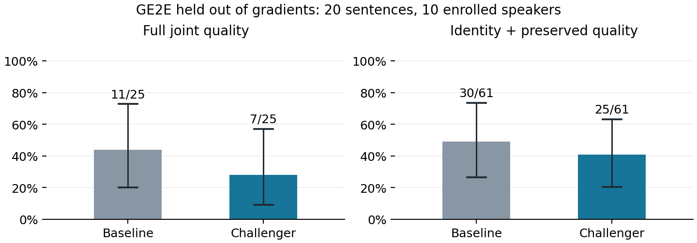

# Voice Guard 输出波形反馈与原音质量约束实验

本轮检验最终转换波形的身份排斥，以及原录音身份、内容特征和频谱保留约束。所有配置在新验证开始前冻结，历史第三轮结果、参考库和音频保持原样。

## 主要结果

独立 GE2E/small.en 完整干净控制下，基线为 11/25（44.0%），选定候选为 7/25（28.0%）。完整联合防护的点估计降低，配对差为 -16.00 个百分点。按十位人物整组重采样的描述性 95% 区间为 [-33.33, 0.00] 个百分点。区间包含零。本轮未观察到完整联合提升，保留原生嵌入基线，不将该候选替换为默认方法。

开发阶段按预先规则选择的挑战者为 joint_guard_snr20；开发后的推荐为 joint_guard_snr20。验证用于检验冻结方法，未用来重新选择配置。ECAPA 参与梯度优化，其结果不能充当独立复现证据。

## 干净转换问题的检查

历史第三轮 40 个干净转换对中，完整质量通过仅 6 个；WER、身份、MOS 失败分别为 34、9、6 个，原因可重叠。两个源录音都说同一句 11 词短句，10% WER 门槛只允许一个词错误。不能把干净转换自身失败算作防护成功，也不能因此放宽门槛。

本轮在保留两个原内容源的基础上，事前固定加入另外两句不同文本，共四个源、三个不同文本。新旧方法在完全相同的内容源上配对。所有历史分数不变；本轮总体百分比不能直接与上一轮百分比相减。

对全部四个固定内容源检查原始录音、仅做梅尔反演与 Griffin-Lim 重建、自转换三个阶段：

| 阶段 | 预测 MOS 均值 | small.en WER 均值 | 内容与自然度通过 |
|---|---:|---:|---:|
| 原始内容录音 | 3.850 | 0.00% | 4/4 |
| 仅波形重建 | 4.308 | 4.17% | 4/4 |
| 自转换 | 3.762 | 9.77% | 2/4 |

在这四句中，原始内容和仅重建均通过，自转换出现额外质量失败，说明不能把全部损失归因于波形重建。三个阶段不是可相加的因果分解；自转换和跨人物转换也不等价。完整逐句转录与原音评分保存在 clean-chain-diagnostic.json，诊断未参与内容源选择或调参。

## 方法扩展与实现边界

基线沿用上一轮 native_emb_snr20：原生特征参考，3000 步强扰动、1500 步隐藏阶段、最终 SNR 下限 20 dB。新候选从同一个基线导出的 PCM16 波形起步，统一再优化 240 步，不根据最终评估逐句挑选检查点。

输出身份项：将 AdaIN 解码频谱经梅尔反演、100 轮 Griffin-Lim 和去预加重变为波形，再用冻结 ECAPA 计算本人相对于最相似其他人物的分类间隔。优化目标要求该间隔低于 -0.05，不再强迫转换结果靠近某个最远人物。

原音约束项：ECAPA 对保护原音与干净原音的余弦相似度目标为 0.98，并要求本人分类间隔至少为 0.03；内容编码相对 MSE 的容许值为 0.02；256/512/1024 点多分辨率频谱相对偏差容许值为 0.08。约束超额项加权后进入损失，权重每 20 步自适应调整。它们是软目标，不保证导出音频一定满足这些值。

硬约束保持每步掩蔽投影、20 dB SNR 下限、扰动峰值和波形余量限制。只扰动原有效语音裁剪区间，最终恢复完整上下文并导出 PCM16 后评分。时频投影经过重建后仍可能存在超额，不据此声称严格不可闻。

为控制计算量，Griffin-Lim 前 98 轮的相位梯度截断，只反传最后 2 轮。前向仍运行完整 100 轮。这是近似梯度；真实开发样本的波形相关系数为 0.9999999995、相对误差约 0.0000307，证明前向一致性，不证明截断梯度等于完整梯度。

内容保留目前采用 AdaIN 内容特征和频谱代理，并未直接优化 ASR 或真人 MOS。GE2E、MOSNet、Whisper 不进入梯度损失；GE2E 等开发评分用于一次全局方法选择，随后冻结新验证。仅输出身份的消融候选保留相同初始化、步数和硬约束。

## 冻结方案与开发结果

开发沿用原三句；新验证为十位已注册人物各两个新句，共二十句。验证句不属于注册前 30 句或已优化的旧验证句。四个固定内容源构成 80 个相关转换对，基线和一个挑战者合计 160 条验证记录。

优化内容源为 p225_002、p225_003；评估为 p226_002、p227_002、p225_003、p226_004。其中 p225_003 源录音参与优化；p226_004 的文本未参与优化。原两内容源和未参与优化文本的结果分别报告。人物仍在注册库内，也可能在 VC 预训练数据中。

选择首先比较完整干净控制下的联合成功数，其次比较严格身份联合、原音质量通过数、原音 WER 与 MOS。只选一个全局挑战者；其开发排序未严格超过基线时保留基线推荐，挑战者仍按冻结方案进行一次配对验证。

| 开发方法 | 完整联合成功数 | 严格身份成功数 | 原音质量通过 | 原音 MOS | 原音 WER |
|---|---:|---:|---:|---:|---:|
| 原生嵌入基线 | 3 | 7 | 3/3 | 3.571 | 0.00% |
| 仅输出身份 | 5 | 10 | 3/3 | 3.571 | 0.00% |
| 输出身份＋原音约束 | 5 | 10 | 3/3 | 3.577 | 0.00% |

开发样本仅三句，同一句的不同内容转换相关；该表用于选参，不是泛化结论。失败候选与所有评分均保留。两种新候选的联合成功计数相同，原音 MOS 打破并列；这不能单独证明原音约束提高了防护率。

## 同句配对的新验证

本表挑战者为 输出身份＋原音约束（joint_guard_snr20）。严格身份联合要求转换身份改变；论文 Eq.10 结构还允许转换自然度或内容失败。完整干净控制额外要求零扰动转换本身满足全部质量门槛。

| 指标 | 原生嵌入基线 | 冻结挑战者 |
|---|---:|---:|
| 严格身份联合 | 30/61（49.2%） | 25/61（41.0%） |
| 身份控制下 Eq.10 | 36/61（59.0%） | 33/61（54.1%） |
| 完整干净控制下 Eq.10 | 11/25（44.0%） | 7/25（28.0%） |
| 保护原音预测 MOS | 4.028 | 4.013 |
| 保护原音 WER | 4.70% | 3.98% |
| 完整波形平均 SNR | 20.60 | 21.50 |
| 原音身份保留 | 20/20 | 20/20 |
| 原音全部质量通过 | 16/20 | 16/20 |

图 1：GE2E 不参与梯度优化。误差线为按十位人物整组重采样的描述性 95% 区间，重复句子和内容源未视为独立人物。样本有目的地取自注册人物，区间不建立总体代表性。

| 固定内容源 | 基线完整联合 | 挑战者完整联合 | 基线严格身份 | 挑战者严格身份 |
|---|---:|---:|---:|---:|
| p226_002 | 2/4（50.0%） | 1/4（25.0%） | 7/14（50.0%） | 5/14（35.7%） |
| p227_002 | 2/7（28.6%） | 2/7（28.6%） | 7/17（41.2%） | 8/17（47.1%） |
| p225_003 | 0/0（N/A） | 0/0（N/A） | 8/14（57.1%） | 6/14（42.9%） |
| p226_004 | 7/14（50.0%） | 4/14（28.6%） | 8/16（50.0%） | 6/16（37.5%） |

完整联合终点的配对变化：

| 两法都失败 | 仅基线通过 | 仅挑战者通过 | 两法都通过 |
|---:|---:|---:|---:|
| 69 | 4 | 0 | 7 |

挑战者保护原音的非互斥失败原因：身份 0 句、MOS 1 句、WER 3 句。仅保护原音新增 WER 越过 10% 门槛的有 0 句。全部 80 个转换中仍被 GE2E 认作本人的有 31 个。

验证结束后的 transfer-audit.json 保留代理与独立声纹的分歧。完整联合中四个由成功变失败的转换对，原音质量仍合格，转换内容与自然度也均合格，但转换身份被 GE2E 认回本人。该描述不参与调参或改变已冻结选择，也不能单独证明固定间隔阈值是唯一原因。

## 代理模型结果与结论边界

| ECAPA/base 辅助结果 | 基线 | 挑战者 |
|---|---:|---:|
| 严格身份联合 | 31/55（56.4%） | 26/55（47.3%） |
| 完整干净控制 Eq.10 | 9/20（45.0%） | 6/20（30.0%） |

ECAPA 已参与输出身份和原音保留的梯度优化，任何 ECAPA 分数提升都可能是对代理模型的适配，不能代替 GE2E 的独立检查。原音 MOS 是自动模型预测；仍缺真人听测、第二种 VC 和原论文规模评测。

完整联合防护的点估计降低，配对差为 -16.00 个百分点。按十位人物整组重采样的描述性 95% 区间为 [-33.33, 0.00] 个百分点。区间包含零。本轮未观察到完整联合提升，保留原生嵌入基线，不将该候选替换为默认方法。

论文表 2 的一个白盒设置报告联合防护 80.06%、保护原音 MOS 4.07、WER 7.84%。本轮内容源、样本、评估检查点和 ASR 不同，不能据小样本点估计宣称达到或超过整篇论文质量。以上方法属于本项目的探索性扩展，不声称文献首创。

## 复核与交付

代码：vguard/joint_recovery.py；运行：scripts/run_joint_recovery.py；冻结与分析：tools/prepare_joint_recovery.py、tools/analyze_joint_recovery.py。脚本核验模型、输入、代码和评估器摘要；完成的状态与选择拒绝覆盖。所有实验与第三轮隔离。

证据目录 docs/evidence/2026-11-09-joint 包含协议、全局选择、原始分数、转录、历史干净失败审计和新的重建诊断。离线复核可运行 tools/analyze_joint_recovery.py，--run 指向解压后的 outputs/joint_recovery/2026-11-09。

独立归档 joint-evidence.tar.gz 已在本机核验：862 个成员、372 条评分音频路径；SHA256 b231f74d1f2d7dd8ca9b1a9dbb242d528c33557154bcedb8d8888aa47f09c5f0。归档含新输入、注册原型和实际执行源码；模型权重沿用此前资源包。报告生成在归档核验后完成，因此报告自身不在该实验归档中。

复跑应在独立工作副本恢复归档的 executed-source、输入、注册原型和原模型/ASR资源，保留冻结协议与选择，在空的运行输出目录执行固定 validation。已有完整状态会直接返回，不会覆盖历史结果。修改配置或再次调参应创建新协议，并使用尚未查看的验证句。
