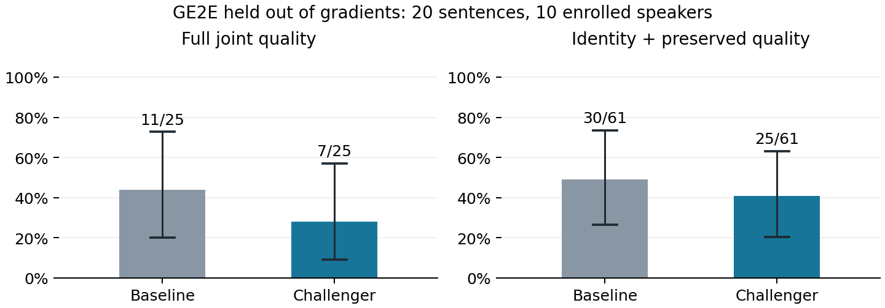
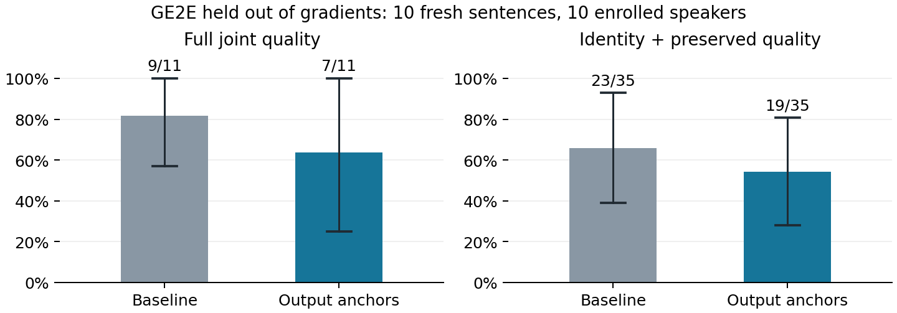

# Voice Guard 联合质量优化与防护保持实验

本报告记录两次相互隔离的探索：最终波形身份反馈，以及保留基线防护的相对目标。配置与选择先冻结，再评估新的句子；不把开发集上的好结果当作论文质量复现。

## 主要结论

第一轮在二十个新句上，完整质量联合由基线 11/25（44.0%） 变为 7/25（28.0%）。完整联合点差为 -16.00 个百分点。按人物整组重采样的描述性 95% 区间为 [-33.33, 0.00]。区间包含零，尚不能证明稳定提升。该候选未改善本轮完整联合结果，保留配对基线。

后续防护保持方案在另取的十句上，完整联合为 7/11（63.6%），同句基线为 9/11（81.8%）。完整联合点差为 -18.18 个百分点。按人物整组重采样的描述性 95% 区间为 [-62.50, 20.00]。区间包含零，尚不能证明稳定提升。该候选未改善本轮完整联合结果，保留配对基线。

两轮使用不同的新句，只能分别与各自的配对基线比较。不能挑出较高的一个百分比当作统一成绩，也不能把两种方法的转换对合并成一个总体成功率。

## 干净链路检查

上一轮两个内容源都说同一句 11 词短句，40 个干净转换只有 6 个通过完整质量筛选。WER、身份、MOS 失败分别为 34、9、6 个，原因可重叠。两项本轮研究均在保留原内容源的基础上，事前固定加入另外两句不同文本，总共四个源、三个文本。历史分数和门槛没有改写。

四个内容源的原始录音全部通过自动质量门槛，仅做梅尔反演和 Griffin-Lim 重建后也全部通过，自转换后为 2/4。因此这些小样本不支持把全部内容损失归因于波形重建；VC 模型本身和严格门槛也有限制。完整逐句诊断见第一轮证据。

## 第一轮方法与验证

基线是原生参考下的嵌入优化：3000 步强扰动、1500 步隐藏、最终 SNR 下限 20 dB。新方法从同一个基线 WAV 起步，再优化 240 步，沿着参考录音、VC 解码、波形重建、ECAPA 身份分类间隔反传梯度。另加入保护原音的 ECAPA 身份保留、AdaIN 内容特征和多分辨率频谱软约束。

三句开发中，完整联合由 3/6 提高到 5/6，严格身份联合由 7/11 提高到 10/11；原音均通过。带原音约束和不带约束的候选成功计数相同，仅预测 MOS 打破并列。这不能单独证明原音约束提高了防护。

| 第一轮，20 句 / 10 人 | 配对基线 | 输出反馈＋原音约束 |
|---|---:|---:|
| 完整干净控制 Eq.10 | 11/25（44.0%） | 7/25（28.0%） |
| 严格身份联合 | 30/61（49.2%） | 25/61（41.0%） |
| 身份控制 Eq.10 | 36/61（59.0%） | 33/61（54.1%） |
| 原音质量通过 | 16/20 | 16/20 |
| 原音预测 MOS | 4.028 | 4.013 |
| 原音 WER | 4.70% | 3.98% |

图 1：第一轮二十个新句的配对结果；误差线按人物整组重采样。完整的逐内容源结果和失败分解见 docs/16_输出波形与联合质量优化.md。

## 为什么增加防护保持目标

第一轮损失只要求 ECAPA 的本人分类间隔低于 -0.05。一旦达到该阈值，身份项归零；即便基线原本的扰动更强，原音修复也可能把它削弱到刚过线。这是代理损失的潜在不足，不等于已证明它解释所有失败。

后续候选先用基线在两个固定优化内容上的真实重建波形建立参考，设置三个相对目标：ECAPA 本人分类间隔不高于 min(-0.12，基线间隔-0.02)；ECAPA 与本人的相似度比基线再降低 0.08；原生 AdaIN 编码器对重建波形的本人相似度也比基线降低 0.08。

原生编码器接收实际重建波形的特征，并重新计算裁剪区间。裁剪边界在脱离梯度的波形上确定，再对选中片段反传；这也是近似。新增原生编码器和 ECAPA 都是代理，独立 GE2E 始终不进入梯度。

原音身份、内容特征、频谱软约束和硬性的信噪比、峰值、掩蔽投影保持相同。总步数仍为 240，固定最终步，不根据验证评分逐句挑选音频。相对目标是软惩罚，不能保证导出结果对代理或独立评估一定不退步。

两轮都运行完整 100 轮 Griffin-Lim 前向，只反传最后 2 轮的相位梯度。开发样本的前向波形相关系数为 0.9999999995；这验证前向一致性，不证明近似梯度与完整梯度相同。原音内容约束使用代理特征，不是直接 ASR 或真人 MOS 保证。

## 后续协议与开发门槛

在第一轮部分验证出现退步后，后续方法、资源、代码和另一组十句新验证先行冻结，观察来源的原始部分结果快照也保留。新句不属于注册前 30 句、第一轮验证或更早的优化样本。每位人物一新句，所有人物仍在注册库内，可能参与过 VC 预训练。

事前门槛为三句开发的完整联合至少 5/6、原音质量 3/3；未达到就停止，达到才运行十句新验证。开发集沿用原三句。该门槛是资源分配规则，不是独立质量证明。两轮各自重跑基线，不假定 CUDA 下相同种子就能保证逐字节一致，因此基线的微小差异与本轮配对记录一并保留。

| 后续开发 | 完整联合成功数 | 严格身份成功数 | 原音质量 | 预测 MOS | WER |
|---|---:|---:|---:|---:|---:|
| 原生嵌入基线 | 4 | 8 | 3/3 | 3.571 | 0.00% |
| 防护保持候选 | 5 | 10 | 3/3 | 3.565 | 0.00% |

门槛决定：通过，运行十句新验证。决定文件在新验证之前写入，原始开发结果和负结果保留。

## 防护保持方案的新验证

十句、十位人物、四个内容源、两个方法，共 80 条相关转换记录。每条配对共用同一个干净转换；保护原音质量按唯一原音去重。主评估是 GE2E、原始 MOSNet、Whisper small.en，MOS>=3、WER<=10%，冻结 Basic 文本归一化。

| 指标 | 配对基线 | 防护保持候选 |
|---|---:|---:|
| 完整干净控制 Eq.10 | 9/11（81.8%） | 7/11（63.6%） |
| 严格身份联合 | 23/35（65.7%） | 19/35（54.3%） |
| 身份控制 Eq.10 | 27/35（77.1%） | 26/35（74.3%） |
| 原音质量通过 | 10/10 | 9/10 |
| 原音身份保留 | 10/10 | 10/10 |
| 原音预测 MOS | 3.983 | 3.986 |
| 原音 WER | 0.00% | 2.00% |
| 完整波形平均 SNR | 20.40 | 20.75 |

完整联合点差为 -18.18 个百分点。按人物整组重采样的描述性 95% 区间为 [-62.50, 20.00]。区间包含零，尚不能证明稳定提升。该候选未改善本轮完整联合结果，保留配对基线。

图 2：后续方案的十个新句，另有各自配对基线。与图 1 的句子不同，不能把跨图百分比差异当作算法增益。误差线为按人物整组重采样的描述性区间。

| 内容源 | 基线完整联合 | 候选完整联合 | 基线严格身份 | 候选严格身份 |
|---|---:|---:|---:|---:|
| p226_002 | 0/0（N/A） | 0/0（N/A） | 5/8（62.5%） | 2/8（25.0%） |
| p227_002 | 3/3（100.0%） | 2/3（66.7%） | 7/10（70.0%） | 7/10（70.0%） |
| p225_003 | 0/0（N/A） | 0/0（N/A） | 5/8（62.5%） | 5/8（62.5%） |
| p226_004 | 6/8（75.0%） | 5/8（62.5%） | 6/9（66.7%） | 5/9（55.6%） |

完整联合的配对变化：两法都失败 30 对、仅基线通过 3 对、仅候选通过 1 对、两法都通过 6 对。

保护原音失败原因可重叠：身份 0 句、MOS 0 句、WER 1 句；新增 WER 越阈值 1 句。四十个保护转换仍识别为本人的有 12 个。

p225_109 的原文为 “That might help a bit.”，基线 small.en 转录正确，候选转录为 “That's might help a bit.”。五词句出现一个词差异即为 WER 20%，超过冻结的 10% 门槛，导致该原音对应的四个转换对均不计联合成功。这既说明内容特征代理不能保证 ASR 内容门槛，也说明短句联合指标对单词错误敏感；没有据此删除样例或放宽阈值。

p225_003 源录音参与优化；p226_004 的文本未参与优化。两个原短句内容源保留为对照。各源分母都报告，不根据验证质量更换源或门槛。English 文本归一化仅作诊断，没有替换主判据。

| ECAPA/base，参与优化的代理 | 基线 | 候选 |
|---|---:|---:|
| 完整联合 | 4/5（80.0%） | 4/5（80.0%） |
| 严格身份联合 | 15/28（53.6%） | 17/28（60.7%） |

ECAPA 和原生 AdaIN 编码器参与优化，它们的分数不构成独立防护证据。置信区间按人物整组重采样，四个内容源未被视作四个独立人物；有目的抽取的注册人物样本不建立总体代表性。

## 复现质量判断

后续防护保持方案在另取的十句上，完整联合为 7/11（63.6%），同句基线为 9/11（81.8%）。完整联合点差为 -18.18 个百分点。按人物整组重采样的描述性 95% 区间为 [-62.50, 20.00]。区间包含零，尚不能证明稳定提升。该候选未改善本轮完整联合结果，保留配对基线。

论文表 2 一个白盒设置为联合防护 80.06%、保护原音 MOS 4.07、WER 7.84%。本项目样本、VC 重建链路、身份检查点和 ASR 不同；仍缺第二种 VC、真人听测和原论文规模验证，因此不能把某个小样本百分比当作全面达到原文质量。方法是本项目的探索性扩展，不声称文献首创。

## 证据、软件检查与复跑

第一轮不可变归档已核验 862 个成员，SHA256 b231f74d1f2d7dd8ca9b1a9dbb242d528c33557154bcedb8d8888aa47f09c5f0。后续归档已核验 550 个成员，SHA256 28526b1cedade34a67347d33125e407a5e5c57cd09941a7eb7f6656c599c0229。原有三份归档不覆盖。

归档包含实际导出 WAV、转录、分数、协议、选择、参考原型、新输入和执行源码快照；模型与 ASR 权重沿用两个已有资源包。完整模型包 VoiceGuard-model-resources-complete.zip 需配合约 515 MB 的 VoiceGuard-quality-evaluator-resources.zip，后者含原始 MOSNet、GE2E 和 small.en；资源摘要由协议核验。

新增梯度、重建一致性、硬约束和协议选择测试与原有测试共 45 项，在云端全部通过。软件检查通过不等于防护指标达标。报告生成在实验归档核验之后，因此报告自身由 Git 与交付核验记录保存。

第一轮运行入口 scripts/run_joint_recovery.py；后续入口 scripts/run_anchored_joint.py。后者复用同一运行器，仅替换冻结协议和优化函数。开发门槛由 tools/decide_anchored_validation.py 强制检查。两个阶段分别保存，不把第一轮失败结果改写为后续成功。

离线复核使用 tools/analyze_joint_recovery.py，分别传入对应 --evidence 和解压后的 --run。重复配对、错误分母、协议或导出文件变化会被拒绝。重新推理请在独立工作副本恢复 executed-source 和资源，使用空运行目录与原冻结选择；已有完整状态会直接返回。修改算法或继续选参应创建新协议并保留新的未知验证句。

后续方法说明、协议与原始结果位于 docs/evidence/2026-11-09-joint-anchored；第一轮完整报告为 docs/16_输出波形与联合质量优化.md。
