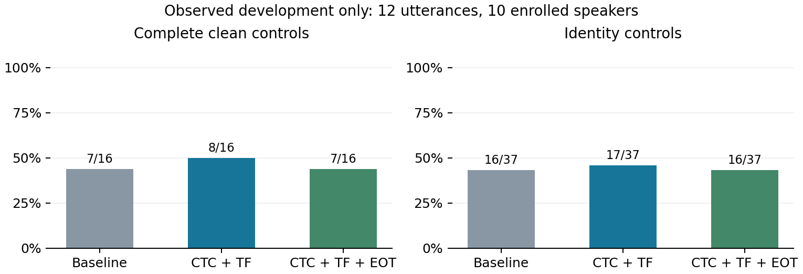
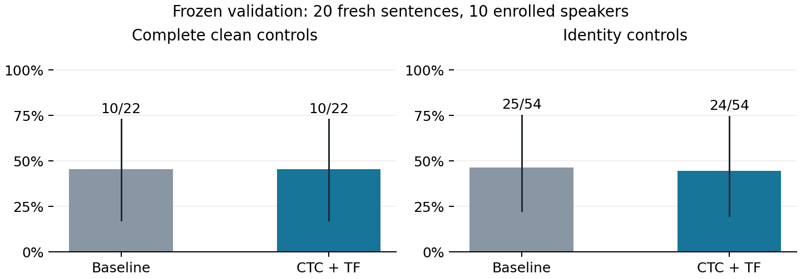

# Voice Guard 内容监督与环境鲁棒优化

本报告研究如何在保留原音内容的条件下改进语音防克隆。它是独立实验扩展，保留既有基线、协议与全部负结果。用户提供的 Kalypta/Treble 博客仅作设计灵感，不作为已核实的算法或产品性能证据。

## 主要结果

十二个此前已观察的句子被明确划作开发集，十位注册人物、四个固定内容源、三个方法，共 144 条相关转换记录。开发结果不能当作未知测试集成绩。

| 方法 | 完整联合 | 严格身份联合 | 原音质量 | 预测 MOS | WER |
|---|---:|---:|---:|---:|---:|
| 原生嵌入基线 | 7/16（43.8%） | 16/37（43.2%） | 10/12 | 4.162 | 4.26% |
| CTC＋时频分配 | 8/16（50.0%） | 17/37（45.9%） | 10/12 | 4.163 | 4.26% |
| CTC＋时频分配＋环境变化 | 7/16（43.8%） | 16/37（43.2%） | 10/12 | 4.162 | 4.26% |

开发门槛通过，随后运行二十个新句。完整联合：配对基线 10/22（45.5%），所选候选 10/22（45.5%）。严格身份联合分别为 25/54（46.3%） 和 24/54（44.4%）。

新验证只比较事前选定的一个候选，不能根据新分数重新选择另一种方法或导出检查点。

图 1：已观察开发句上的完整干净控制和身份控制结果，三个方法共用匹配干净控制。四个内容源属于相关重复，不是四倍独立人物。

## 来源审核与任务区别

用户给出的 CSDN 文章于 2026 年 11 月 5 日发布，描述 Kalypta 令机器难以转录、真人仍可听懂。本项目的课程质量门槛要求原音转录正确，因此不采用防 ASR 损失，而使用 CTC 内容保留监督。

文章未提供可核实的 Kalypta 原始论文、官方代码、权重和完整配置；1.2M 参数、低于 12ms、识别率降至 11.3% 均不作为本项目事实。ISO 226 等响曲线也不能证明任意低于 1dB 的扰动不可听。Treble 官方介绍波动有限元和几何声学，不支持把文中麦克斯韦方程叙述当成声学仿真依据。来源审核摘要保存在 research-review.json。

## 方法与可执行约束

每句先运行相同的原生嵌入基线：3000 步强扰动、1500 步隐藏，最终 SNR 下限 20dB。两个候选从同一 PCM16 基线起步，再各优化 160 步。防护目标仍是 AdaIN 原生参考编码器的目标人物吸引和本人排斥，不反传最终输出的 Griffin-Lim 相位梯度。

内容监督使用冻结的 torchaudio WAV2VEC2_ASR_BASE_960H，以真实参考文本计算 CTC 损失，在完整参考上下文中反传到保护裁剪。训练字符归一化仅服务该检查点，不改变冻结 Basic 归一化或最终 WER<=10% 门槛。GE2E、MOSNet 和两种 Whisper 都不参与梯度或音频接受决策。

分别归一化身份梯度和 CTC 梯度，以两者短时频谱的相对敏感度生成 [.1,1] 权重，再做时频平滑，将更新分配给身份梯度较强、内容梯度较弱的位置。之后移除一阶上会增加 CTC 的冲突分量。该门控只是局部启发式，既不等同于可解释的声纹频带，也不保证下一步真实转录不变。

加入环境变化的候选循环使用原始参考、两组固定房间一阶镜像反射、三抽头麦克风响应以及 8kHz 降采样/恢复。干净原音和保护原音通过同一变换后计算原生身份目标。两组房间只含一次反射，未模拟弥散混响、完整设备或实测平台链路，不称为完整 Treble 或 pyroomacoustics 仿真。

每八步检查一次训练代理：CTC 不高于基线+0.01；原音 ECAPA 相似度不低于基线-0.005；相对频谱距离不高于基线+0.01；原始条件身份目标不高于基线+0.005；环境平均目标不高于上个接受点+0.0001。失败则退回上个接受波形并减小步长。SNR、掩蔽、峰值与余量继续投影。

实际 PCM16 导出后、独立评分之前，再检查相同代理上限；越限则复制本句基线 WAV。该回退是事先定义的训练算法，不是根据最终 WER/MOS/GE2E 挑选音频；即便通过代理检查，独立质量仍可能退步。

## 代理接受与实际更新

| 候选 | 接受块 | 拒绝块 | 梯度冲突次数 | PCM 回退 | 与基线逐字节相同 |
|---|---:|---:|---:|---:|---:|
| CTC＋时频分配 | 192 | 48 | 1075 | 0 | 0/12 |
| CTC＋时频分配＋环境变化 | 181 | 59 | 1052 | 0 | 0/12 |

更新块和冲突次数是优化机制记录，不是独立防护成功数。CTC 是训练代理，不应将其下降写成最终 Whisper WER 已改善。

本次开发中没有出现基线原音合格、候选原音新增质量失败的句子；这不保证其他新句也能保持。

## 开发选择与停止规则

一次全局开发选择为 CTC＋时频分配。新验证要求完整联合严格提高、严格联合和唯一原音质量数不下降、保留每一个基线原音质量通过句，宏平均 WER 不高于基线+0.5 个百分点、预测 MOS 不低于基线-0.05。

| 事前门槛 | 实际判定 |
|---|---|
| 完整联合严格提高 | 通过 |
| 严格身份联合不下降 | 通过 |
| 原音质量通过数不下降 | 通过 |
| 每个基线合格原音仍合格 | 通过 |
| WER 在预定容差内 | 通过 |
| 预测 MOS 在预定容差内 | 通过 |

开发集有意纳入旧失败与更多人物，仍可能对既有观测过拟合。扩大开发范围有助于暴露退步，不能替代新验证。没有通过门槛时不靠换句、放宽阈值或重复选择继续消耗预留测试集。

## 二十个新句的独立验证

十位已注册人物各两句、四个固定内容源、配对基线与唯一已选候选，共 160 条转换记录。句子不在开发、此前优化/验证或注册库句子中；人物可能出现在 VC 预训练中，不能称为完全未见人物。

| 主指标 | 配对基线 | 所选候选 |
|---|---:|---:|
| 完整干净控制联合 | 10/22（45.5%） | 10/22（45.5%） |
| 严格身份联合 | 25/54（46.3%） | 24/54（44.4%） |
| 身份控制 Eq.10 | 29/54（53.7%） | 28/54（51.9%） |
| 原音质量通过 | 17/20 | 17/20 |
| 原音身份保留 | 20/20 | 20/20 |
| 原音预测 MOS | 4.046 | 4.045 |
| 原音 WER | 3.89% | 3.89% |
| 平均 SNR | 20.69 | 20.69 |

完整联合点差为 +0.00 个百分点。按人物整组重采样的描述性 95% 区间为 [0.00, 0.00] 个百分点。完整联合逐对判定相同，重采样点差恒为零；这不代表总体差异已精确确定为零。开发与新验证结果分别保留；单次小样本不构成论文总体质量复现。新验证未建立完整联合改善，继续保留原生嵌入基线。

| 固定内容源 | 基线完整联合 | 候选完整联合 | 基线严格身份 | 候选严格身份 |
|---|---:|---:|---:|---:|
| p226_002 | 1/4（25.0%） | 1/4（25.0%） | 6/13（46.2%） | 5/13（38.5%） |
| p227_002 | 3/6（50.0%） | 3/6（50.0%） | 7/15（46.7%） | 7/15（46.7%） |
| p225_003 | 0/0（N/A） | 0/0（N/A） | 6/12（50.0%） | 6/12（50.0%） |
| p226_004 | 6/12（50.0%） | 6/12（50.0%） | 6/14（42.9%） | 6/14（42.9%） |

基线原音合格而候选新增质量失败的句子数为 0。原音身份、MOS 和 WER 的失败原因分别记录，不根据验证音频重新挑选检查点或回退。

PCM16 实测掩蔽阈超额频点比例的逐句均值为基线 6.20%、候选 6.18%，正超额的全频点均值分别为 0.0428 和 0.0305dB。投影被实际执行，但重建一致性与 PCM16 量化后仍有残差，不能写成所有频点严格零超额。

严格身份联合的退步对为 p230_080 / p226_002：基线转换被 GE2E 判为 p228，候选转换被判为 p230。完整联合还允许转换音质或内容被破坏，因此严格身份退步不一定改变完整联合判定。

图 2：二十个新句的配对验证，误差线按人物整组重采样。完整联合逐对相同，严格身份联合有一个基线通过对退步。小样本区间不建立总体代表性。

四个内容源沿用上一研究的固定设置，优化参考目标不使用这些转换的最终评分。所有内容源和零分母均报告，没有按干净质量事后换源。该数据集与之前两项研究不同，不能跨轮比较百分比当作算法增益。

## 固定信道诊断

在任何信道结果产生前固定四个已观察句、一个内容源，所有三个方法都评测原始、另一个房间响应及 MP3 64kbps 条件，共 36 条记录。新房间几何不在训练的两组响应中，但保护原音句子已用于开发；因此只能称有限信道诊断，不能称新句泛化。

房间核使用一致的 L1 归一化以避免放大削波；各方法与其干净参考使用相同变换。每个条件重新转换并独立评分干净参考，干净控制失败不会记作防护成功。

| 条件 | 方法 | 完整联合 | 严格身份联合 | 原音质量 |
|---|---|---:|---:|---:|
| identity | 原生嵌入基线 | 1/3（33.3%） | 1/4（25.0%） | 3/4 |
| identity | CTC＋时频分配 | 1/3（33.3%） | 1/4（25.0%） | 3/4 |
| identity | CTC＋时频分配＋环境变化 | 1/3（33.3%） | 1/4（25.0%） | 3/4 |
| heldout_room | 原生嵌入基线 | 1/3（33.3%） | 1/4（25.0%） | 2/4 |
| heldout_room | CTC＋时频分配 | 1/3（33.3%） | 1/4（25.0%） | 2/4 |
| heldout_room | CTC＋时频分配＋环境变化 | 1/3（33.3%） | 1/4（25.0%） | 2/4 |
| mp3_64k | 原生嵌入基线 | 1/3（33.3%） | 1/4（25.0%） | 3/4 |
| mp3_64k | CTC＋时频分配 | 1/3（33.3%） | 1/4（25.0%） | 3/4 |
| mp3_64k | CTC＋时频分配＋环境变化 | 1/3（33.3%） | 1/4（25.0%） | 3/4 |

零分母保留为 N/A。上述信道分数不参与方法选择，不能从某个较高百分比推断总体鲁棒性。

本次有限信道诊断中三个方法的成功计数相同，未观察到环境变化候选的额外优势。房间处理使三个方法的原音质量通过数都从 3/4 降到 2/4，说明该预处理本身也会损伤质量，不能将其算作候选防护增益。

## 测试、证据与复跑

新增七项数值与门槛检查后，全部 52 项单元测试在云端通过。真实语音的 CTC 输入梯度非零且有限，所有模型权重冻结。软件测试不替代独立质量测量。

不可变归档在本机核验 1360 个成员、673 个 WAV，评分路径逐项匹配 636 个；SHA256 d279eb814c51eacbc98bbd3a58dc689768aca632d4df4d1be9abe5c98e95b4eb。包含原始输入、注册原型、执行源码、输出波形、转录、选择、门槛及全部负结果。历史归档保留。

权重分发需要已有完整模型包和质量评估包，另补充 VoiceGuard-content-ctc-resources.zip，其准确摘要在 ctc-resource-receipt.json。包内 checkpoints/ctc/wav2vec2_fairseq_base_ls960_asr_ls960.pth 约 360MiB，通过官方 torchaudio 下载；本机逐项核验。也可运行 tools/fetch_content_ctc.py 下载并对照冻结协议校验；不将大权重或私钥提交 Git。

运行入口 scripts/run_content_robust.py，使用新工作副本和空输出目录；完整状态不会重复覆盖。开发选择和门槛工具为 tools/decide_content_validation.py。离线审核 tools/audit_content_results.py 使用 --evidence 和 --run 指向证据与解压后的运行目录。信道诊断入口 tools/probe_content_channels.py。修改方案必须新建协议，不能覆盖本次执行字节。

本轮没有真人 MOS、第二种 VC、实时生成器或真实房间录制；不能宣称达到论文整体质量，也不能宣称 Kalypta 产品复现。报告记录实际观测和局限，课程加分及验收由教师决定。实验结束不会自动关闭 ECS。

来源：用户提供的 CSDN 文章 https://blog.csdn.net/weixin_33139275/article/details/170178909；Treble 官方 https://www.treble.tech/；相关开源声学工具 https://github.com/LCAV/pyroomacoustics。
